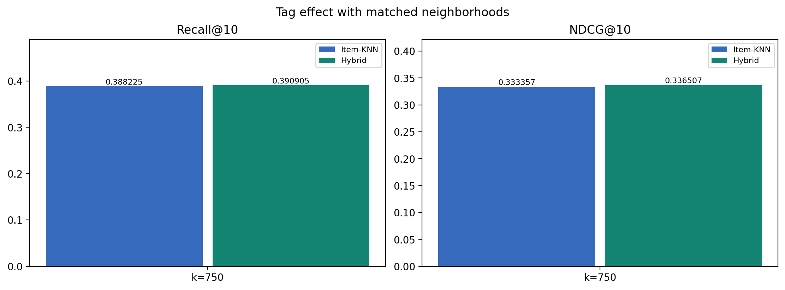

# KuaiRand 추천 시스템 텀프로젝트

**연구 질문: 시청 이력 기반 Item-KNN에 영상 태그를 추가하면 추천 성능이 좋아지는가?**

인기순 추천, Item-KNN, Hybrid를 비교하고 기존 사용자 ID로 영상 최대 10개를 추천합니다.

## 빠른 실행 순서

**처음 실행:** 저장소 다운로드 → 가상환경 생성 → 라이브러리 설치 → 원본 CSV 준비 → 아래 순서대로 실행

**데이터 준비:** `split_data.py` → `preprocess_data.py` → `prepare_candidates.py`

**모델 생성·검증:** `popularity.py` → `run_item_knn.py` → `content.py` → `run_hybrid.py`

**평가·분석·데모:** `run_test.py` → `analyze_results.py` → `demo.py`

모델 생성까지 완료했다면 `src/demo.py`를 실행하여 추천을 확인할 수 있습니다.

## 1. 환경 준비

Windows PowerShell 기준이며 개발에 사용한 Python은 3.13.7입니다.
아래 명령은 프로젝트를 처음 내려받을 때 실행합니다.

```powershell
git clone https://github.com/junhyeokjjangjjangman/kuairand-recsys.git
cd kuairand-recsys
py -3.13 -m venv .venv
.\.venv\Scripts\python.exe -m pip install -r requirements.txt
```

주요 라이브러리: pandas, NumPy, SciPy, scikit-learn, Matplotlib.

이후 명령은 모두 `requirements.txt`가 있는 프로젝트 최상위 폴더에서 실행합니다.

## 2. 원본 데이터 준비

[KuaiRand 공식 배포 페이지](https://kuairand.com/)에서 **KuaiRand-Pure**를 준비합니다.

다음 세 파일을 `data/raw` 바로 안에 넣습니다.

```powershell
New-Item -ItemType Directory -Force .\data\raw
```

| 파일 경로 | 용도 |
|---|---|
| `data/raw/log_standard_4_08_to_4_21_pure.csv` | 학습용 일반 노출 로그 |
| `data/raw/log_random_4_22_to_5_08_pure.csv` | 검증·테스트용 무작위 노출 로그 |
| `data/raw/video_features_basic_pure.csv` | 영상 ID와 태그 정보 |

`data/raw/`와 `data/processed/`는 Git 관리 대상에서 제외합니다.

처음 내려받은 경우 원본 데이터 준비와 전처리·모델 생성이 필요합니다.

## 3. 전체 실험 실행

한 명령이 정상적으로 끝나면 다음 명령을 실행합니다.

```powershell
.\.venv\Scripts\python.exe .\src\split_data.py
.\.venv\Scripts\python.exe .\src\preprocess_data.py
.\.venv\Scripts\python.exe .\src\prepare_candidates.py
.\.venv\Scripts\python.exe .\src\popularity.py
.\.venv\Scripts\python.exe .\src\run_item_knn.py
.\.venv\Scripts\python.exe .\src\content.py
.\.venv\Scripts\python.exe .\src\run_hybrid.py
.\.venv\Scripts\python.exe .\src\run_test.py
.\.venv\Scripts\python.exe .\src\analyze_results.py
```

분석의 부트스트랩 계산 중에는 출력이 잠시 멈춰 있을 수 있습니다.

마지막에 `Saved analyses to:`가 나오면 분석이 완료된 것입니다.

같은 전처리 데이터를 사용해 탐색 설정을 바꿨다면 `run_item_knn.py`부터 다시 실행하여 모델과 결과를 갱신합니다.

## 4. 추천 데모

```powershell
.\.venv\Scripts\python.exe .\src\demo.py
```

- `User ID:`에 기존 사용자 ID를 입력합니다. 예: `5`
- 영상 ID와 추천 점수를 최대 10개 출력합니다.
- 결과는 `results/demo_user_5.csv`처럼 저장합니다.
- 종료하려면 `q`를 입력합니다.

데모는 전체 영상 목록에서 해당 사용자의 **학습 기간 전체 노출 영상**을 제외하고 추천합니다.

양성 학습 이력이 없는 기존 사용자는 인기순 추천을 받습니다.

추천 점수는 순위를 정하는 값이며 시청 확률이나 정확도를 뜻하지 않습니다.

## 5. 데이터 처리와 평가 조건

| 구분 | 기간 | 로그 종류 |
|---|---|---|
| 학습 | 2022-04-09 ~ 2022-04-21 | 일반 노출 |
| 검증 | 2022-04-22 ~ 2022-04-28 | 무작위 노출 |
| 테스트 | 2022-04-29 ~ 2022-05-08 | 무작위 노출 |

기간을 먼저 나누고 각 기간 안에서 중복 사용자-영상 쌍을 통합합니다.

한 번이라도 `long_view=1`이면 해당 기간의 관심 기록을 1로 처리합니다.

0은 관심 기준을 충족한 행동이 관찰되지 않았다는 뜻이며 비호감으로 단정하지 않습니다.

평가 조건은 다음과 같습니다.

- 학습 기간에 서로 다른 관심 영상이 5개 이상인 사용자.
- 평가 기간에 무작위로 노출된 영상 중 학습 기간 전체 노출 영상을 제외한 후보.
- 남은 후보가 20개 이상이고 정답 1과 0이 각각 하나 이상 존재.
- 모든 모델에 동일한 사용자·후보·정답을 적용.
- 검증·테스트 기록은 학습 행렬과 사용자 취향 벡터에 추가하지 않음.

검증 사용자는 **2,322명**, 테스트 사용자는 **7,737명**, 테스트 후보는 **527,231쌍**입니다.

| 지표 | 의미 |
|---|---|
| Recall@10 | 후보 안의 관심 영상 중 상위 10개로 찾아낸 비율 |
| NDCG@10 | 관심 영상을 높은 순위에 얼마나 잘 배치했는지 평가 |

지표는 사용자별로 계산한 뒤 평균을 냅니다.

동점은 영상 ID 오름차순으로 처리합니다.

## 6. 모델과 설정 선택

| 모델 | 점수 계산 |
|---|---|
| Popularity | 학습 기간에 관심을 보인 서로 다른 사용자 수 |
| Item-KNN | 후보 영상의 이웃 중 사용자 학습 관심 영상과의 코사인 유사도 합 |
| Hybrid | 정규화한 CF 점수와 태그 점수의 가중합 |

영상은 46개 태그의 이진 벡터로 표현합니다.

사용자 취향은 학습 관심 영상들의 태그 벡터 평균으로 만들고 후보 태그 벡터와의 코사인 유사도를 계산합니다.

`Hybrid = alpha * CF_normalized + (1 - alpha) * Content_normalized`

두 점수는 사용자별 후보 안에서 0~1로 정규화합니다.

태그가 없는 후보의 콘텐츠 항은 0으로 두고 모든 후보에 같은 CF 가중치를 적용합니다.

사용 가능한 사용자 태그가 없거나 점수 범위가 상수인 경우에도 해당 콘텐츠 항 또는 정규화 값은 0입니다.

계산 규칙은 `uniform_cf_weight_v2`입니다.

| 탐색 항목 | 범위 |
|---|---|
| 이웃 수 | 20, 50, 100, 200, 300, 500, 750, 1000 |
| CF 가중치 alpha | 0.25, 0.50, 0.75, 0.80, 0.90, 1.0 |

설정은 **검증 NDCG@10**으로 선택합니다.

alpha=1.0은 CF만 사용하는 대조 설정입니다.

| 모델 | 검증에서 선택한 설정 | 검증 NDCG@10 |
|---|---|---:|
| Item-KNN | k=750 | 0.340528 |
| Hybrid | k=1000, alpha=0.8 | 0.349759 |

## 7. 테스트 결과

### 같은 이웃 수에서 태그 효과

| 모델 | 설정 | Recall@10 | NDCG@10 |
|---|---|---:|---:|
| Item-KNN | k=750 | 0.388225 | 0.333357 |
| Hybrid | k=750, alpha=0.8 | 0.390905 | 0.336507 |

태그 추가 시 평균 Recall은 상대적으로 약 **0.69%**, NDCG는 약 **0.94%** 높았습니다.

사용자 단위 대응 BCa 부트스트랩 20,000회, seed=42로 계산한 NDCG 평균 차이는 **+0.003150**이며, 95% 신뢰구간은 **[+0.001072, +0.005231]**입니다.

NDCG의 소폭 평균 개선을 뒷받침하지만 Recall 개선은 통계적으로 확실하지 않습니다.

사용자별 NDCG 변화는 **개선 35.23% / 동률 30.02% / 하락 34.74%**입니다.

평균 개선이 모든 사용자의 개선을 뜻하지 않습니다.



### 모델별 검증 최적 설정 비교

| 모델 | 설정 | Recall@10 | NDCG@10 |
|---|---|---:|---:|
| Popularity | 별도 튜닝 없음 | 0.363685 | 0.303846 |
| Item-KNN | k=750 | 0.388225 | 0.333357 |
| Hybrid | k=1000, alpha=0.8 | 0.391684 | 0.337335 |

- Hybrid는 Item-KNN보다 Recall 약 **0.89%**, NDCG 약 **1.19%** 높았습니다.
- Hybrid는 Popularity보다 Recall 약 **7.70%**, NDCG 약 **11.02%** 높았습니다.

위 수치는 상대 개선율(%)입니다.

모델별 선택 설정 비교에는 이웃 수 변경 효과도 포함됩니다.

Item-KNN 대비 NDCG 개선에는 통계적 근거가 있지만 Recall 개선은 확실하지 않습니다.

## 8. 분석 결과와 코드 위치

| 위치 | 내용 |
|---|---|
| `src/config.py` | 데이터 경로·기간·평가 조건·탐색 범위 |
| `src/analyze_results.py` | 같은 k 비교·대응 통계·그래프·사용자 사례 분석 |
| `results/best_settings.json` | 검증에서 선택한 설정 |
| `results/final_test_settings.json` | 테스트에 사용한 설정 |
| `results/final_test_metrics.csv` | 세 모델의 최종 테스트 성능 |
| `results/analysis_k750/analysis_summary.txt` | 추가 분석 결과와 해석 |
| `results/analysis_k750/same_k750_metrics.csv` | 같은 k=750에서의 비교 |
| `results/analysis_k750/paired_bootstrap_results.csv` | 신뢰구간·개선/동률/하락 비율 |
| `results/analysis_k750/performance_by_history.csv` | 관심 이력 수에 따른 집단별 성능 |
| `results/analysis_k750/case_descriptions.json` | 개선·하락 추천 사례 설명 |
| `results/analysis_k750/case_improved_top10.csv` | 개선 사례의 추천 목록 |
| `results/analysis_k750/case_worsened_top10.csv` | 하락 사례의 추천 목록 |
| `results/analysis_k750/analysis_settings.json` | 분석 설정·환경·입력 해시 |

추가 분석 폴더의 `01`~`06` PNG·PDF는 다음 그래프입니다.

1. 같은 이웃 수에서 태그 효과
2. NDCG 차이의 신뢰구간
3. 이웃 수별 검증 성능
4. 이웃 수·가중치별 검증 성능
5. 초기·최종 설정 비교
6. 사용자 집단별 성능

`CF750`은 Item-KNN k=750을 뜻합니다.

`HY750`과 `HY1000`은 각각 k=750과 1000의 Hybrid(alpha=0.8)를 뜻합니다.

초기 비교용 `HY100`은 k=100, alpha=0.75입니다.

추천 사례는 같은 k=750에서 개선 집단과 하락 집단 각각의 NDCG 변화가 중앙값에 가까운 사용자를 선택합니다.

## 9. 결과 해석과 한계

- 평가 대상은 일정 수준의 학습 관심 이력과 평가 노출이 있는 사용자입니다.
- 평가는 무작위 노출 후보 안에서 수행하며 데모는 전체 영상 목록을 사용합니다.
- 초기 테스트를 확인한 뒤 탐색 범위를 확장하고 추가 분석을 수행했습니다. 새로운 미사용 테스트의 확증으로 표현하지 않습니다.
- 검증표는 명시한 범위를 재계산한 자료이며 팀의 원래 전체 확장 탐색 기록은 아닙니다.
- 신뢰구간은 학습 모델을 고정한 사용자 표본 변동에 대한 비교별 구간입니다. 여러 비교의 동시 95% 보장을 뜻하지 않습니다.
- 사용자 집단별 평균과 두 추천 사례는 설명 분석이며 집단 간 유의성 검정 결과는 아닙니다.

## 10. 실행 중 문제가 생겼을 때

| 증상 | 확인할 내용 |
|---|---|
| 원본 CSV를 찾지 못함 | `data/raw` 바로 안의 파일명과 경로 확인 |
| 전처리 CSV·모델 NPZ를 찾지 못함 | 전체 실행 순서에서 앞 단계를 완료했는지 확인 |
| `matplotlib` 모듈이 없음 | 가상환경 Python으로 `pip install -r requirements.txt` 실행 |
| 새로운 이웃 수의 점수 파일이 없음 | `run_item_knn.py`부터 다시 실행 |
| `Complete Step 1` 오류 | 확장 검증·설정 선택·테스트 실행까지 완료했는지 확인 |
| 알 수 없는 사용자 ID | 데이터에 존재하는 사용자 ID 입력. 예: `5` |

저장소: https://github.com/junhyeokjjangjjangman/kuairand-recsys